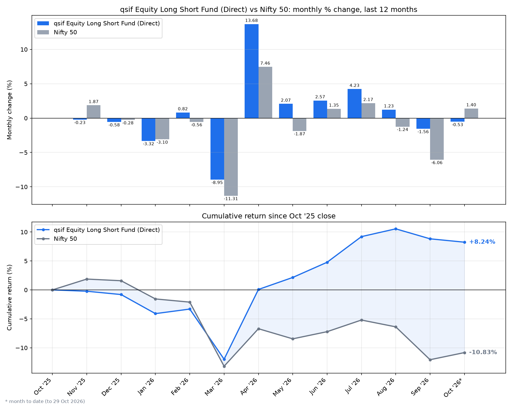
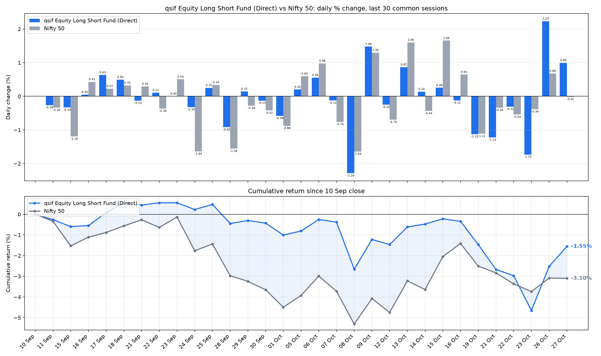
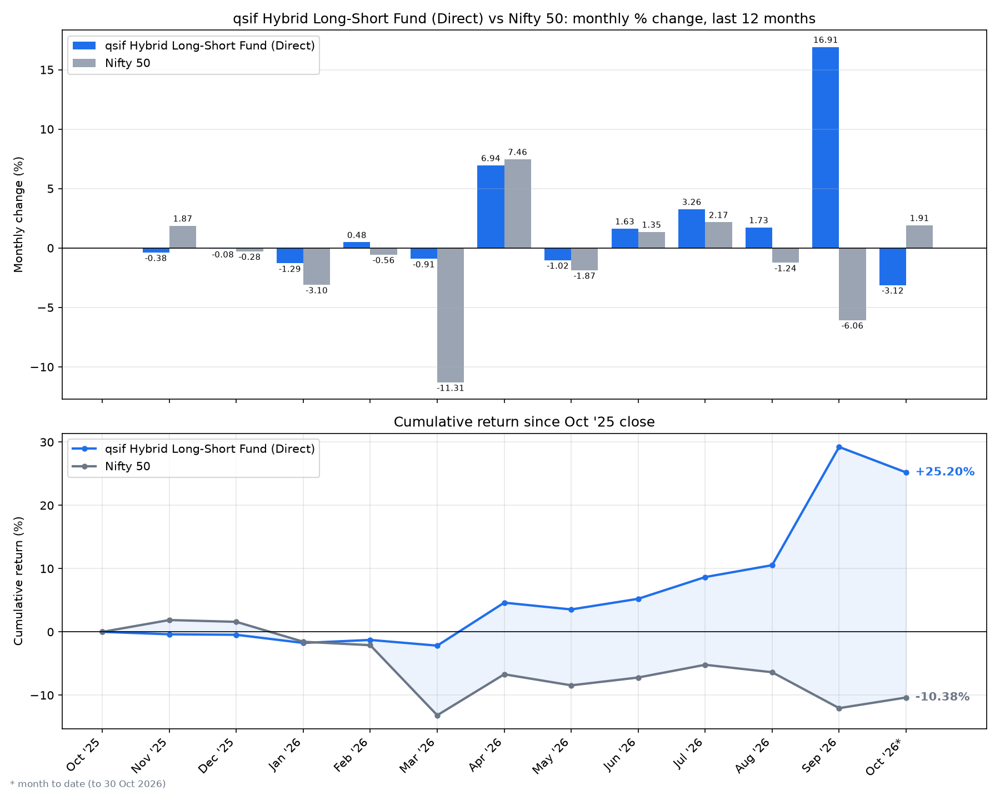
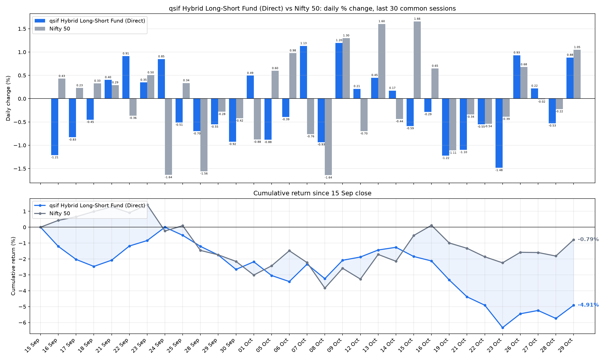
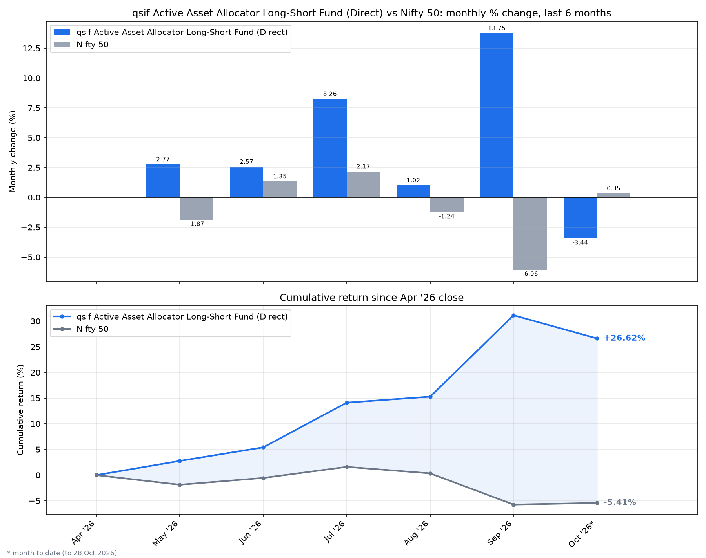
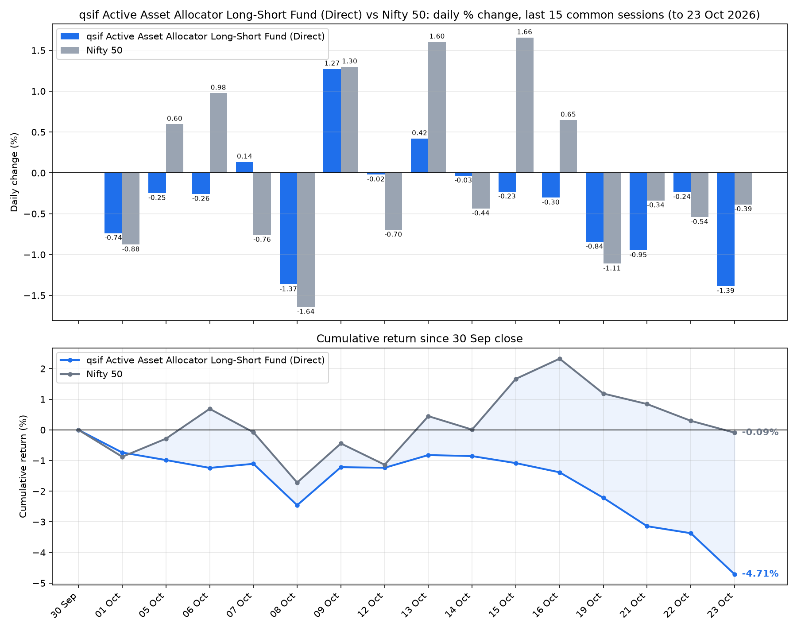
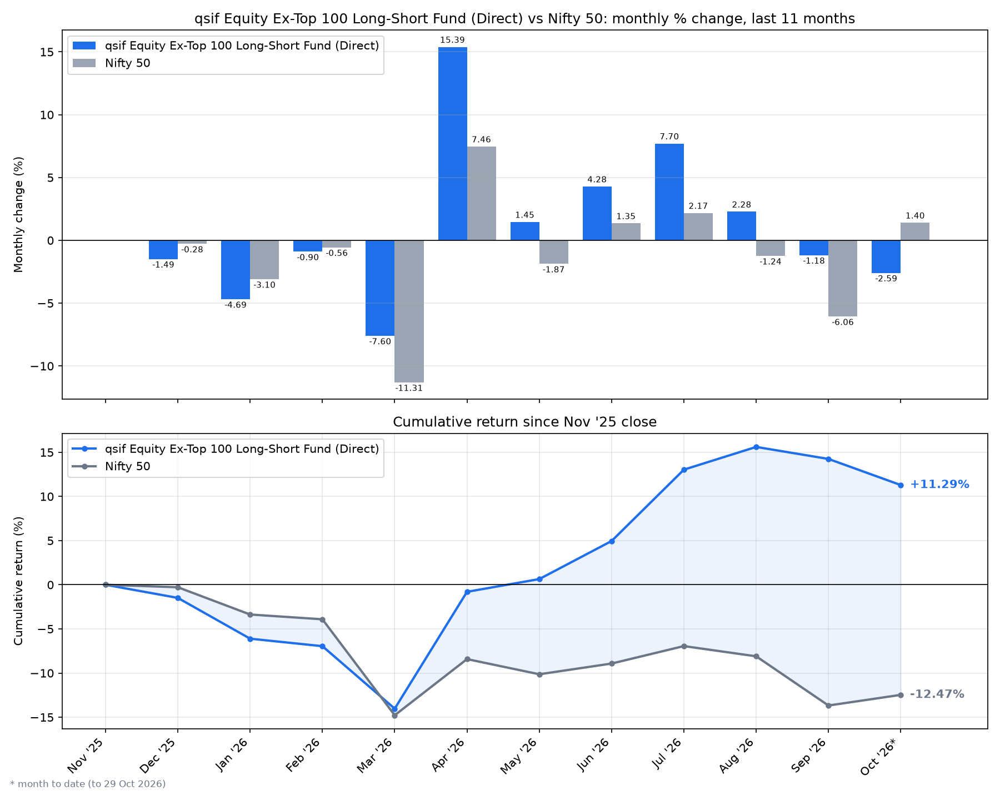
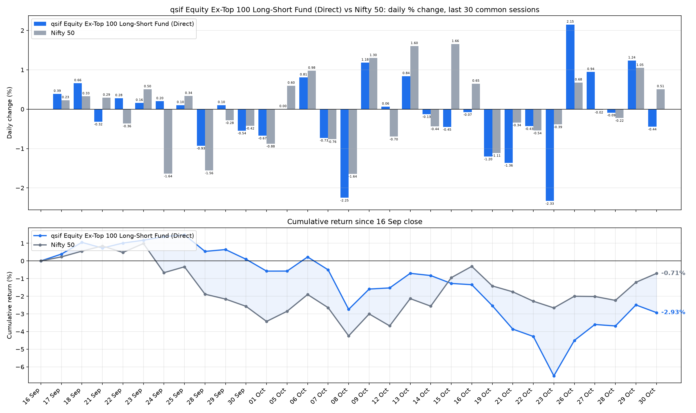

# SIF funds vs Nifty 50

Daily (last 30 sessions) and monthly (last 12 months) % change as bars, with
cumulative return as lines, for each fund against Nifty 50.
Updated automatically by GitHub Actions on weekday mornings.

## qsif Equity Long Short Fund (Direct)

### Monthly, last 12 months

### Daily, last 30 sessions

## qsif Hybrid Long-Short Fund (Direct)

### Monthly, last 12 months

### Daily, last 30 sessions

## qsif Active Asset Allocator Long-Short Fund (Direct)

### Monthly, last 12 months

### Daily, last 30 sessions

## qsif Equity Ex-Top 100 Long-Short Fund (Direct)

### Monthly, last 12 months

### Daily, last 30 sessions

- Fund NAVs: free Charlie API (`/v1/sif/hnav/{code}`)
- Nifty 50 closes: yfinance (`^NSEI`)
- Data tables: the `.csv` files in [`charts/`](charts/)
- Add or change funds: edit `SCHEMES` at the top of `sif_vs_nifty.py`
- New funds show fewer months until they have enough history
- This file is regenerated on every run

Only dates present in both series are used, so each bar compares the same period.
For education and research, not investment advice.
