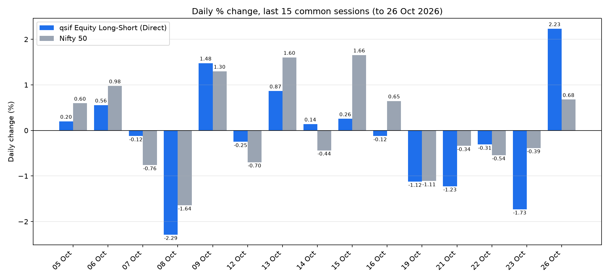

# qsif Equity Long-Short (Direct) vs Nifty 50

Daily % change of the fund against Nifty 50 for the last 15 common sessions.
Updated automatically by GitHub Actions on weekday mornings.

- Fund NAVs: free Charlie API (`/v1/sif/hnav/1`)
- Nifty 50 closes: yfinance (`^NSEI`)
- Data table: [`sif_vs_nifty_log.csv`](sif_vs_nifty_log.csv)
- Run manually: Actions tab > "Daily SIF vs Nifty chart" > Run workflow
- Run locally: `pip install -r requirements.txt && python sif_vs_nifty.py`

Only dates present in both series are used, so each bar compares the same session-to-session move.
For education and research, not investment advice.
